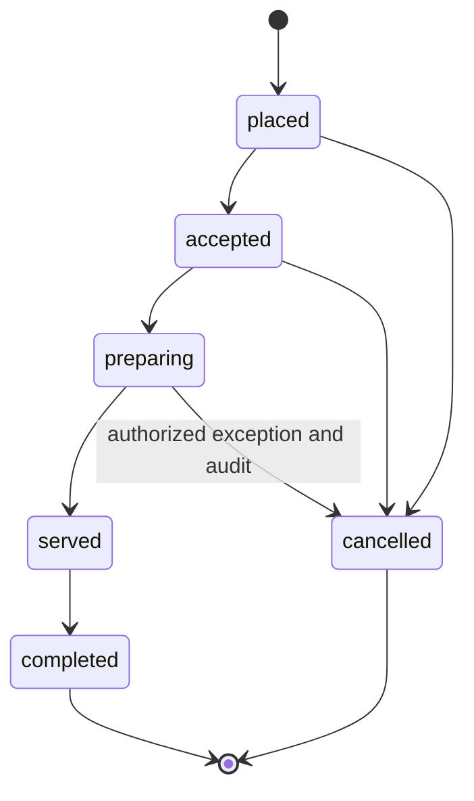
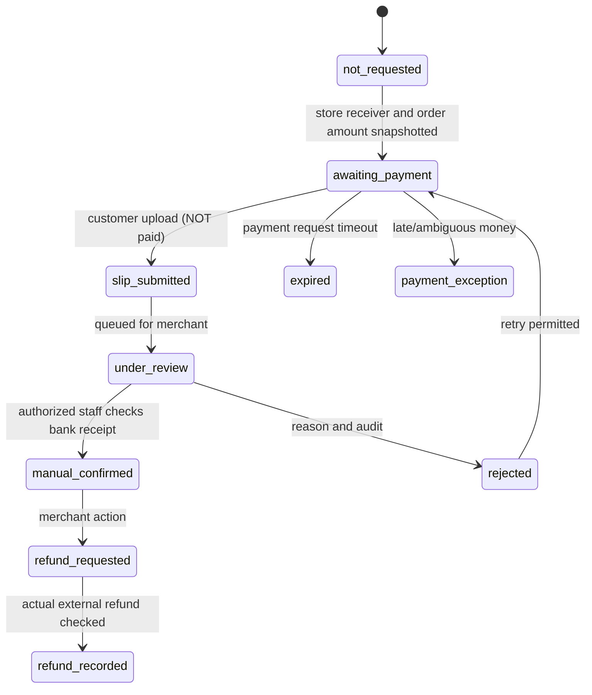

# RCAT POS — State models and transaction invariants

## Order lifecycle (G2/G3)

Order acceptance or preparation is independent of Payment until G5 introduces a *validated* pay-first policy. State transitions are enforced server-side with tenant and role authorization, version checks and audit log. No silent backward transitions.

## Payment lifecycle (G5-M1 — not implemented during G0–G4)

A standard personal PromptPay QR can be identical for equal receiver and amount across Orders; internal IDs are not bank transaction references. A slip/QR/redirect/OCR never proves settlement. Merchant may record `manual_confirmed` **only after checking incoming bank transactions**. `provider_verified` belongs exclusively to optional future M2; late transfers, cancellation, duplicate or mismatched amounts go to exceptions, not automatic state reversal.

## Monetary and concurrency invariants
- Authoritative amount stored as integer satang (THB); line item price/discount/tax are immutable snapshots at placement.
- Idempotency key scoped to tenant/store/guest session and payload hash, with a bounded retention policy; key reuse with different body is conflict.
- Order changes and its outbox event commit in one database transaction; realtime delivery may retry without creating duplicate Orders.
- Payment request is logically one per Order at a time, distinct payment attempts and immutable audit records.
- Multiple Orders for a table share context, but not a combined payment obligation in MVP.
- No public client API can grant paid state. M1 manual reconciliation requires authorized merchant confirmation after checking actual bank incoming transaction, amount, currency, store receiver and any merchant-entered bank reference (unverified by RCAT POS).

## Examples of adverse flow handling
| Condition | Expected behavior |
|---|---|
| Double submit or network retry | Idempotent Order response, no duplicate charge/order |
| Out of stock during checkout | 409 conflict with refreshed choices; re-confirm |
| QR expired/revoked | 410/403, prompt new session; no previous customer's bill exposed |
| Two staff devices advance state | Optimistic concurrency prevents stale updates |
| Merchant phone asleep | Persisted unacknowledged queue, refetch on resume |
| Identical Order totals | Distinct logical requests; provider-level unique references not assumed |
| Duplicate slip / reused reference | Flag potential reuse and require a distinct bank-receipt review; no auto-paid inference |
| Customer transfer after cancellation/expiry | Payment exception, manual bank check and possible external refund; no silent change |
| Manual payment claim | Permissioned merchant action *after bank check*, never provider_verified |
| Manual refund pending/failed | No automatic refund claim; preserve external refund evidence and immutable audit |
