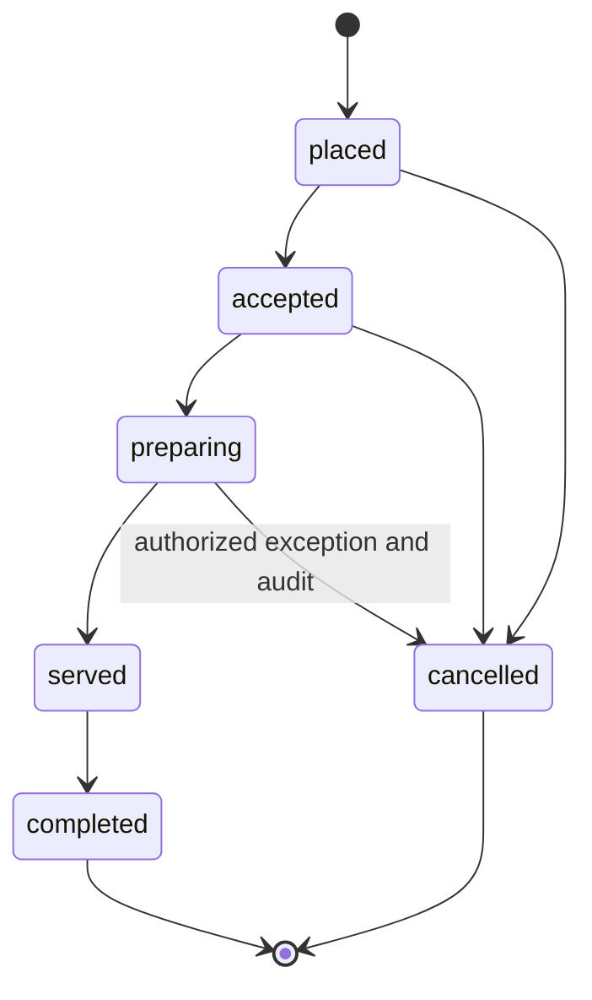
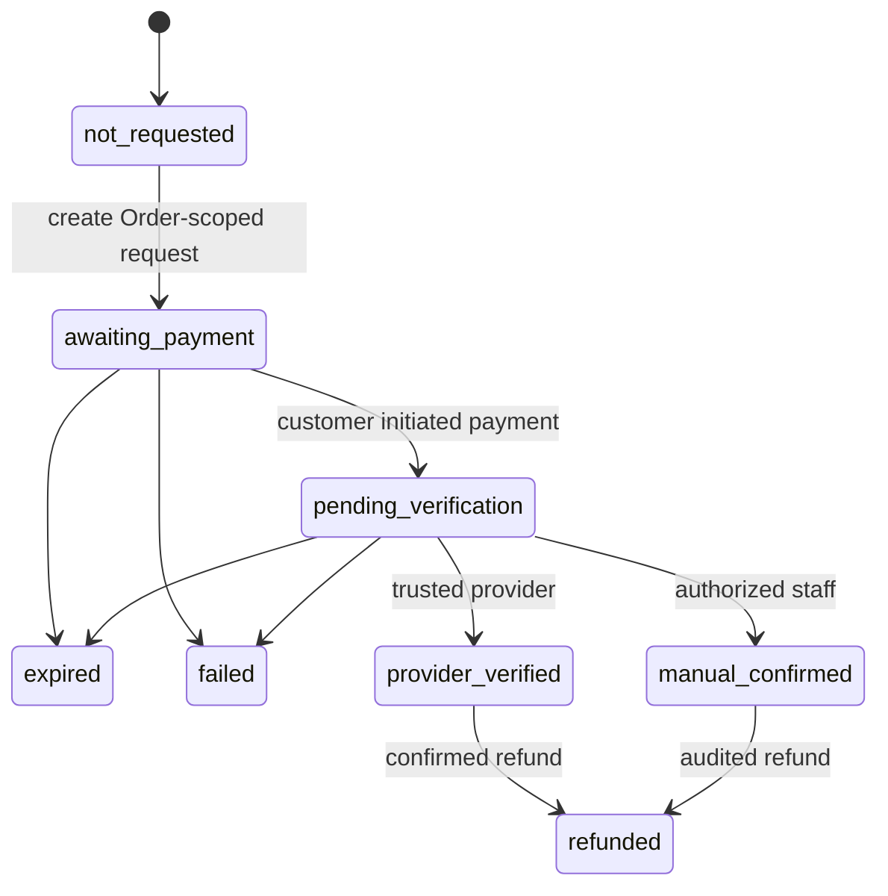

# RCAT POS — State models and transaction invariants

## Order lifecycle (G2/G3)

Order acceptance or preparation is independent of Payment until G5 introduces a *validated* pay-first policy. State transitions are enforced server-side with tenant and role authorization, version checks and audit log. No silent backward transitions.

## Payment lifecycle (G5 — not implemented during G0–G4)

Never equate browser redirect, QR creation or user-uploaded slip with provider-verified settlement. Manual confirmation must be visibly distinct and auditable. Late provider notifications require exceptions/reconciliation; they must not silently resurrect an expired order.

## Monetary and concurrency invariants
- Authoritative amount stored as integer satang (THB); line item price/discount/tax are immutable snapshots at placement.
- Idempotency key scoped to tenant/store/guest session and payload hash, with a bounded retention policy; key reuse with different body is conflict.
- Order changes and its outbox event commit in one database transaction; realtime delivery may retry without creating duplicate Orders.
- Payment request is logically one per Order at a time, distinct payment attempts and immutable audit records.
- Multiple Orders for a table share context, but not a combined payment obligation in MVP.
- No API can grant paid state from a public client. Payment reconciliation checks amount, currency, merchant destination and trusted transaction reference.

## Examples of adverse flow handling
| Condition | Expected behavior |
|---|---|
| Double submit or network retry | Idempotent Order response, no duplicate charge/order |
| Out of stock during checkout | 409 conflict with refreshed choices; re-confirm |
| QR expired/revoked | 410/403, prompt new session; no previous customer's bill exposed |
| Two staff devices advance state | Optimistic concurrency prevents stale updates |
| Merchant phone asleep | Persisted unacknowledged queue, refetch on resume |
| Identical Order totals | Distinct logical requests; provider-level unique references not assumed |
| Payment webhook duplicate/out-of-order | Verify signature, idempotent receipt and reconciliation |
| Payment success after cancellation | Exception, support workflow, possible refund; no silent change |
| Manual payment claim | Permissioned action, not provider_verified |
| Refund failure | Pending/error state, retry/reconcile; immutable audit |
